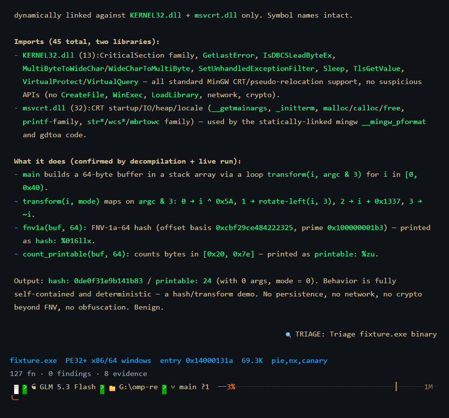
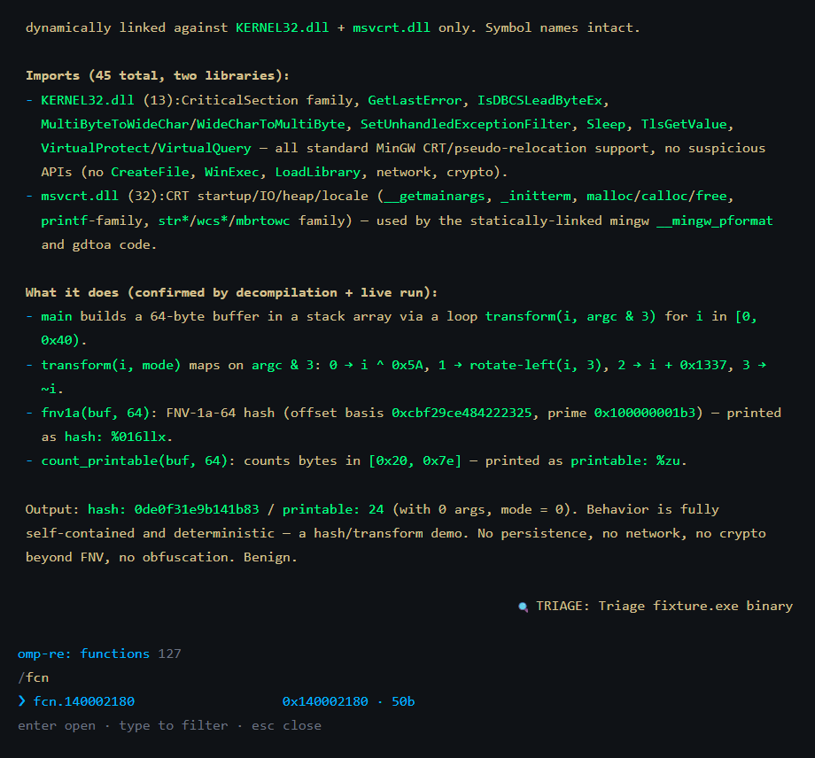
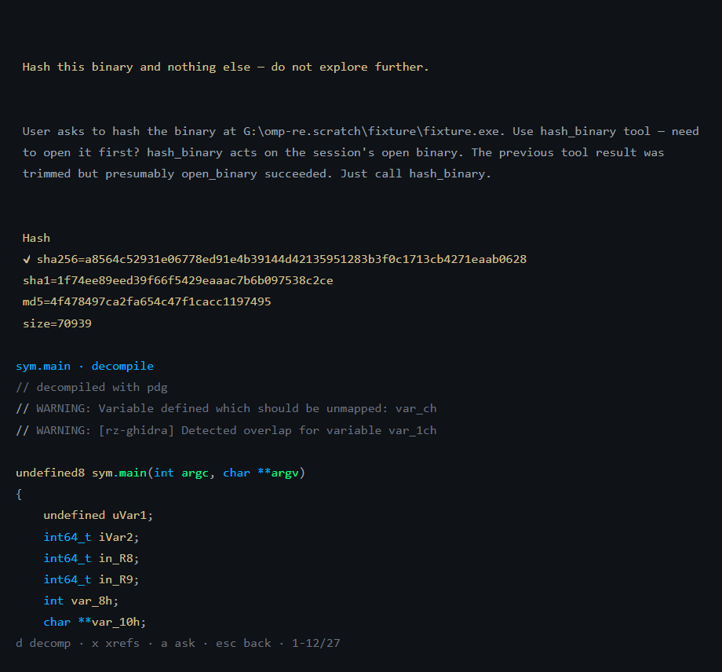
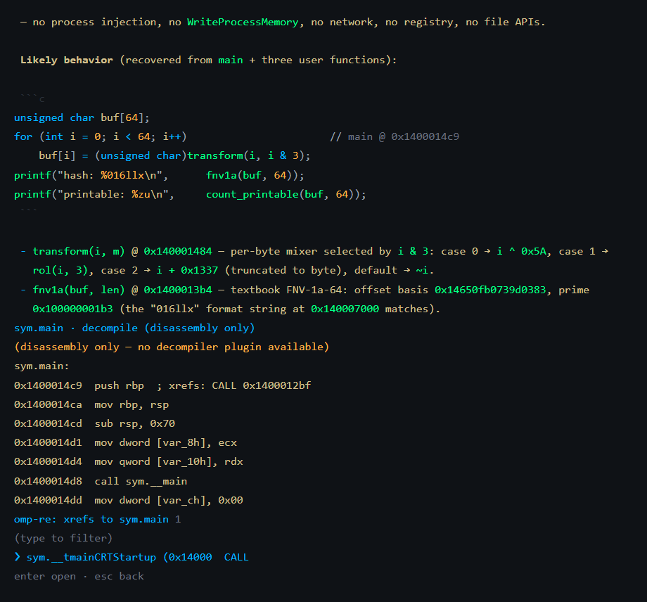

# omp-re

[](https://github.com/drvova/omp-re/actions/workflows/ci.yml)
[](LICENSE)




`omp-re` is a reverse-engineering plugin for [omp](https://omp.sh) (oh-my-pi).
It registers **no tool, no slash command and no flag** with omp: the model
drives [rizin](https://rizin.re) from the one code tool omp already has, its
own `eval`, through a small library the plugin's skill loads there —
`re.open`, `re.cmd`, `re.json`, `re.call` and a handful more in JavaScript, the
same as `omp_re.*` in Python. Behind it are a content-addressed evidence
store, an HMAC-signable audit log, findings that are checked against their
evidence when they are recorded, and a report writer that refuses to write a
claim with no supporting evidence. Beside it: a status band, three overlay
panels on keys, and a packaged `re-analyst` subagent. The agent gathers facts
through the engine; the evidence store remembers exactly what it observed; the
report writer will not let it claim more than that.

The work is done by one engine, written in Common Lisp (`engine/`), which also
runs as a [nodecode](#also-a-nodecode-cell) cell. Under omp it runs as an SBCL
process beside omp, so **omp-re needs [SBCL](https://www.sbcl.org) and the
cl-ppcre library as well as rizin** — see [Prerequisites](#prerequisites).

## Install

```bash
omp plugin marketplace add drvova/omp-re
omp plugin install omp-re@drvova
```

`drvova` after the `@` is the *marketplace catalog name* declared inside
`.omp-plugin/marketplace.json`; it happens to match the GitHub owner but is a
separate identifier (the `marketplace add` argument is the GitHub `owner/repo`,
the `@name` is the catalog).

To update an installed copy to the latest published version:

```bash
omp plugin marketplace update drvova   # re-fetch the catalog first — upgrade reads a local cache
omp plugin upgrade omp-re@drvova
```

`omp plugin upgrade` reinstalls from a **local cache** of the marketplace
catalog, so without the `marketplace update` refresh it just reinstalls the
version you already have (and looks like it did nothing). Omit the name from
`marketplace update` to refresh every marketplace.

`omp plugin list` shows the installed version. (A dev-load via the
`extensions:` config below has nothing to upgrade — a fresh `omp` start picks
up your checkout.)

To develop against a local checkout instead of installing as a plugin, point
omp at the checkout's root — the directory with `package.json`, not
`extensions/re` inside it. omp loads the extension the package names and, with
it, the `skills/` and `agents/` beside it; without the skill the model has
neither the manual nor the library to load:

```yaml
# ~/.omp/agent/config.yml
extensions:
  - /path/to/omp-re
```

There is no build step of yours. The TypeScript in `extensions/re` loads
natively through Bun, and the engine's Lisp is compiled, and saved as an
image, when the engine first starts after a change: an edit to either is
picked up on the next omp start. Never use a real home
directory in this config (`/path/to/omp-re`, not a machine-specific path).

**SBCL and cl-ppcre are required.** The extension starts the engine with the
`sbcl` on your `PATH` (or the one `OMPRE_SBCL_PATH` names). Without SBCL, or
without cl-ppcre where SBCL's ASDF can find it, a session is told what to
install when it starts, and so is every call the model makes. The first omp start after an install or an
upgrade compiles the engine and saves an image of it, which takes a few
seconds; later starts run the image and take a few milliseconds. A release's
prebuilt image runs without SBCL at all.
[`docs/install.md`](docs/install.md#sbcl-and-cl-ppcre) has the steps for each
OS, and [what the image is](docs/install.md#the-engine-image).

**rizin is required, and it is yours.** omp-re does not bundle, download,
or build rizin: it runs the `rizin` on your `PATH` (or the one
`OMPRE_RIZIN_PATH` names), so you choose the version, update it with your
package manager, and keep the decompiler plugins you already have. If a
desktop launch of omp didn't inherit your shell `PATH` (so `rizin` works in
your terminal but omp-re can't see it), omp-re also looks in the common
install locations — Homebrew, `/usr/local/bin`, `/usr/bin`, `/opt/rizin/bin`,
snap, `~/.local/bin`; set `OMPRE_RIZIN_PATH` to its full path for anywhere
else (the output of `which rizin`). When it truly can't be found, opening a
binary says so and points at `OMPRE_RIZIN_PATH`. See
[Prerequisites](#prerequisites) and [`docs/install.md`](docs/install.md).

## Quickstart

There is nothing to type but what you want. With rizin, SBCL and cl-ppcre
installed, ask omp in plain words:

```
analyse /bin/ls: what is it, what does it link against, and what does main do?
```

The model reads the `re-triage` skill, loads the library into `eval`, opens the
binary and works from there; the status band under the transcript shows the
open binary and the counts as they grow. While it works, or after:

```
alt+g            # function navigator; type to filter (fuzzy)
Enter            # open a function in the code view
d                # toggle decompiled C
x                # follow the selected xref
a                # hand the function off to the model with a grounding prompt
```

Then ask for what you want kept — "record what you found and write the report
to ls.md", "verify the report", "carry ls.md.manifest.json onto ./ls-v2" — and
the model runs the engine's lines for it. Or delegate a whole analysis: ask omp
to run the `re-analyst` agent on a binary path. It opens the binary in its own
rizin process, follows the triage order, and returns structured findings that
each cite the output and address behind them.

## Host-native: everything inside omp's `eval`

omp-re adds no tool menu of its own, and no second code tool: omp's `eval` is
the code host, and it is the only way in. The plugin's skill, `re-triage`,
ships one library for each of `eval`'s kernels, and the model loads the one for
the language it is writing:

| Kernel | Load line (a cell of its own) | Global | Calls |
| --- | --- | --- | --- |
| JavaScript | `%load skill://re-triage/recipes.js` | `re` | async — `await re.cmd("aflj")` |
| Python | `%load skill://re-triage/recipes.py` | `omp_re` | plain — `omp_re.cmd("aflj")` (`re` is Python's regex module there) |

```js
await re.open("/bin/ls");                                  // spawn rizin + full analysis
print(await re.cmd("pdg", "main"));                        // one read-only rizin command, its text
const { data, evidence } = await re.json("aflj");          // a *j command as data, whole, with its evidence id
await re.call("set_comment", { addr: "main", text: "entry" });   // any other tool of the engine
print(await re.triage());                                  // a recipe: the first dozen reads, each line citing its evidence
print(await re.slash("report ls.md"));                     // a line: evidence, findings, verify, report, carry, undo
```

- **Discover:** `re.help()` is the manual — the command families and the tools;
  `re.tools()` lists the tools and `re.doc(name)` one tool's arguments;
  `rizin_help` (through `re.call`) looks up any rizin command's exact
  arguments. The skill's `SKILL.md` is where the model starts.
- **Compose:** loop over functions, filter strings, chain xrefs, and define
  helpers that persist for the session (`eval` state survives compaction). A
  read's text is the `rizin> <cmd>` header line, the output, and the
  `[evidence xxxxxxxx …]` tag on the last line; `re.json` hands over the decoded
  data and the id. A refusal throws, so the code can `try`/`catch`.
- **Recipes:** `re.triage()`, `re.scanImports()`, `re.inspectFunction(addr)`,
  `re.findComparisons(addr)` and `re.findCrypto()` (snake_case in Python) are
  the reads every analysis opens with, written once. Each read a recipe makes
  is audited and recorded as evidence like any other, and every line of its
  report names the evidence id it rests on, ready to cite in `record_finding`.
- **Mind the cell deadline.** An `eval` cell is stopped after 30 seconds unless
  it sets a `timeout`, and time spent in the engine counts. Analysis on open
  can take minutes: give that cell `timeout: 600`. A stopped cell cancels the
  engine's work on its call. A stopped JavaScript cell also loses its kernel —
  load the library again, as omp-re's note under the error says; a Python
  kernel survives. rizin and its analysis are untouched either way.
  [`docs/omp-eval.md`](docs/omp-eval.md) has the details.

**How a cell reaches the engine.** omp gives a plugin no way to put anything
into an `eval` kernel, and a kernel is a separate process. So the extension
listens on the loopback interface — a port the system picks, a 32-byte token —
and leaves a file readable only by you, named for omp's process id, that a
kernel finds its parent's listener by. Each request names the session the
kernel serves; the extension passes it to the engine for that session, and a
cell that times out or is interrupted hangs up, which cancels the engine's
work. [`docs/ARCHITECTURE.md`](docs/ARCHITECTURE.md#omp-the-way-in-from-eval)
has the design and [`SECURITY.md`](SECURITY.md#the-listener-omps-eval-reaches-the-engine-through)
what it does and does not protect.

**What omp approves is the cell.** `eval` is one `exec`-tier tool to omp, so
omp's approval mode and `tools.approval.eval` decide whether a cell runs; what
a cell then asks of the engine is not asked of you again. The engine's own
rules are unchanged and are the control inside a cell: only read-only rizin
commands, files only from allowed directories, the debugger only when you
switched it on. Every call is a line in the audit log.

**Switching it off.** `OMPRE_DISABLED=1` in omp's environment: the extension
then starts nothing — no engine, no listener, no band, no keys. omp's own
plugin enable/disable does the same for good.

## Also a nodecode cell

The same engine runs under [nodecode](https://nodecode.ai), whose model has one
tool — `eval`, evaluating Lisp — and whose extensions are *cells*. This
repository is one: clone it into the cells folder. There the engine is loaded
into nodecode's own Lisp image, so there is no second process and no SBCL of
your own to install: it needs rizin ([`docs/nodecode.md`](docs/nodecode.md#install)
has the one caveat, about cl-ppcre).

```sh
git clone https://github.com/drvova/omp-re ~/.nodecode/cells/nodecode-re
```

The cell (`nodecode-re.asd`, `nodecode/*.lisp`) is the engine (`omp-re.asd`,
`engine/*.lisp`) presented the nodecode way — verbs in the `RE` package, a
`(help :re)` manual, a config section. It registers no tool and no command:
nodecode's model has one tool, `eval`, and everything here is a function
inside it — the same verbs as above, written from the same description
(`recipes/api.json`):

```lisp
(re:open "/bin/ls")                  ; open and analyze
(re:cmd "pdg" "main")                ; one read-only rizin command, at an address
(re:json "aflj")                     ; a *j command, as data to loop over
(re:triage)                          ; the first dozen reads, composed, each line citing its evidence
(re:call "record_finding" :claim "…" :evidence '("1a2b3c4d"))
(re:slash "report analysis.md")      ; a line: report, verify, carry, evidence, findings, undo
```

Evidence, the audit log, findings, annotations with replay, verification, the
report gate and the read-only command policy are the same code under both
hosts. The record follows nodecode's session tree as it follows omp's: after a
rewind, an abandoned branch's annotations are rolled back and its evidence
grounds nothing. See [`docs/nodecode.md`](docs/nodecode.md) for the verbs,
configuration, and what differs from omp (no panels, no status band).

## What's omp-native

`omp-re` uses omp's own extension surfaces rather than working around them:

| omp feature | What omp-re does with it |
| --- | --- |
| The `eval` tool, both kernels | The whole model surface. Nothing is registered: `re.*` in JavaScript and `omp_re.*` in Python are a library loaded with `%load skill://re-triage/…`, asking a loopback listener the extension owns. See [Host-native](#host-native-everything-inside-omps-eval). |
| Skills (`skill://`) | The plugin's skill carries the manual the model starts from, the playbooks, and the library itself; `%load skill://re-triage/recipes.js` resolves wherever the plugin is installed. |
| `tool_call` / `tool_result` on `eval` | Each request a cell makes is written to the audit log under that `eval` call's id and its place in the cell (`<toolCallId>#2`). A cell that fails because the library is not loaded in its kernel gets one line added naming the load line; the model's code is never rewritten. |
| A cell's timeout and interrupt | The kernel hangs up, and the engine's work on that call is cancelled: waiting stops without killing rizin (and its annotations); an analysis that was cut short has its half-analyzed process ended. |
| Session artifacts (`artifact://`) | A text past the context cap is saved in full to the session's artifact store and linked from the result, never discarded. (`re.json` and the recipes get the data whole without it.) |
| Session branches (`getBranch`) | Evidence, annotations, and the open binary follow the active branch: after `/tree` navigation or a branch, an abandoned branch's renames are rolled back and its evidence no longer grounds claims. |
| Session lifecycle events | `--continue`/`/resume` reopen the branch's binary in the background and **replay its annotations** into the fresh rizin process; a crashed or timed-out rizin respawns the same way. |
| Compaction preservation (`session.compacting`) | When omp compacts the conversation, omp-re folds a snapshot of the RE session — open binary, evidence and annotation counts, the most recent evidence ids, the findings — into the summary, so the post-compaction model stays grounded. |
| One engine process | The engine is one SBCL child for the whole omp process; the main session and every task subagent are sessions on its pipe. It ends with the last session, inside omp's shutdown budget, and takes each session's rizin and debugger with it. If it dies, the next call starts another and the sessions come back from their records. What it writes to its standard error goes to omp's log. The extension has no third-party npm dependencies — it resolves only the host's own packages. See [`docs/ARCHITECTURE.md`](docs/ARCHITECTURE.md). |
| Task subagents | The plugin ships `agents/re-analyst.md`, which lists `eval` among its tools and autoloads the skill; it is marked `structured: true` so its output schema is enforced even when `task.structured` is off. A subagent is a session of its own: its own kernel, its own load line, its own rizin. |
| Shortcuts, overlays | `alt+g`, `alt+s` and `alt+i` open the functions, strings and imports of the open binary as panels; a row opens the code view. They show what the engine sends and record no evidence. |
| Footer status, widgets, message renderer, logger | Analysis progress shows in the footer; the binary-facts band is a widget; the line that says a binary was opened is drawn in the transcript; headless warnings go to omp's log. |

## Using all of rizin

The dedicated tools cover the common path; rizin has about 2,000 commands.
Rather than hardcode a list, omp-re reads the catalog rizin publishes about
itself (`rizin -qc '?*j'`: every command in the installed build, plugins
included, with typed arguments and a summary) and uses it three ways:

- **`rizin_help`** answers "which command, and what arguments?" from the rizin
  you actually have, so the model never guesses syntax for the wrong version.
  `rizin_help ph` shows `ph <algo>` with its choices; `rizin_help "rop gadgets"`
  finds `/R`.
- **`rizin_command`** runs one read-only command from that catalog — function
  summaries (`pdsf`), call graphs (`agc`), hexdumps (`px`), entropy
  (`ph entropy @!4096`), byte and ROP searches (`/x`, `/R`), op analysis
  (`ao`), headers (`iH`), config reads (`e asm.arch`, `elj`), metadata and
  string listings (`C`, `Csl`), classes (`acl`), unions and type
  cross-references (`tu`, `tx`), and the FLIRT sigdb listing (`Flt`) — and
  returns rizin's own error and usage text when the arguments are wrong.
  Writes, setting config (`e key=value`), shell escapes, file reads, and
  analysis changes are refused before anything reaches rizin; the get/set
  commands (`e`, `tn`, `Ld`) run only in their read form. See
  [`SECURITY.md`](SECURITY.md#rizin_command).
- **A compatibility check**: when a binary opens, every command omp-re's own
  tools send is looked up in the catalog, and any your rizin lacks is named in
  a warning instead of failing later as an empty result. `re.status()` shows
  the result and which decompiler the catalog lists.

Beyond the in-core commands, rizin's **standalone CLI tools** are one tool
away. `rizin_cli` fronts `rz-bin` (fast headers/imports/strings without full
analysis), `rz-diff` (compare two binaries — versions of a sample, patched vs.
original), `rz-hash` (hashing and entropy), `rz-find` (raw pattern search),
`rz-asm` (standalone assemble/disassemble), and `rz-ax` (base conversion),
each with its own arguments and its own `-h`. Argv only — no shell — and the
flags that write files, run code, fetch over the network, or open an
interactive view are refused.

### Decompiler: whatever you have

The code view and `pdg`/`pdd` via `rizin_command` use the best decompiler plugin
installed — rz-ghidra (`pdg`) then jsdec (`pdd`) by default. `OMPRE_DECOMPILER`
reorders that, or names another plugin's command entirely (any `pdX`-style
decompiler is looked up in rizin's catalog the same way); the built-ins stay
as a fallback. Without
any plugin, output is labeled annotated disassembly, never passed off as
decompiled code.

### Dynamic analysis: the debugger (opt-in)

rizin is also a debugger, and `rizin_debug` drives it — launch the target
(with a controlled argv/env/stdio via `run`), set breakpoints and hardware
watchpoints, continue (including to the next syscall, call, or return),
single-step, read and write registers and memory, disassemble **live**
memory (so self-modified or unpacked code is visible where the static view
can't reach), walk the backtrace, and inspect maps, modules, threads, and
Windows or glibc heaps. This **executes the sample**, so it is off until you
set `OMPRE_ENABLE_DEBUGGER`, and runs in a session separate from the static
one that only ever reads the file. Run untrusted samples only in an
isolated, disposable VM or container — see
[`SECURITY.md`](SECURITY.md#rizin_debug).

Instead of launching locally, `start` can **attach** to an already-running
process (`attach: {pid}`) or **connect to a remote stub** (`attach: {remote:
"gdb://host:port"}`, or `windbg://…`) — so you can drive a sample running
inside an isolated VM from omp-re on the host, the open binary serving as the
symbol source. Everything else about the tool is unchanged.

### Emulation and signatures

Between pure static reading and executing the sample, two more rizin
capabilities are one tool away. `rizin_emulate` runs the target's own code
inside rizin's RzIL VM — no OS process — to recover an argument computation or
walk a decryptor loop. `apply_signatures` names library functions from FLIRT
signatures: `aaa` applies rizin's built-in database on open, and this
re-applies it or applies a custom `.sig`/`.pat` file you provide (re-applied
automatically on resume). `rizin_command Flt` lists the built-in database.

`open_binary` runs rizin's baseline analysis (`aaa`); `analyze` re-runs the
deeper passes it skips — prelude scans that recover functions in stripped
binaries, Go and Objective-C recovery, pointer analysis, recursive type
matching — and reports the function count before and after. A pass is re-run
on resume, before signatures and annotations, so each layer sees the one
below it.

### Loading raw and headerless targets

`open_binary` normally autodetects architecture and base from the file
header. For flat shellcode, a firmware image, or a ROM dump — which have no
header — pass `arch`/`bits`/`map`/`format` (rizin's own `-a`/`-b`/`-m`/`-F`)
so it's disassembled correctly. The choice is remembered and reused if the
session resumes or rizin respawns.

## What it looks like

The screenshots below are real, unmodified captures of an `omp-re` session
triaging a small demo binary on Windows — not mockups. They were taken with an
earlier release; the status band and the panels they show are unchanged.

### Function navigator

`alt+g` opens a fuzzy-filterable, scrollable panel over every analyzed
function:



### Decompile and cross-references

`d` inside the code view toggles decompiled C from rz-ghidra. Without a
decompiler plugin the same view degrades honestly to annotated disassembly,
labeled `(disassembly only — no decompiler plugin available)`, rather than
pretending to have a real decompile — see [Prerequisites](#prerequisites).





### The report gate

The line `report` refuses to write a report containing any claim with zero
backing evidence: the whole report is withheld, the claim is named, and an
IOC in it is defanged even in the refusal. What the model learned some other
way — a shell command, a pasted dump, what it remembers — has no evidence id
behind it and cannot be reported as observed.

### Verified, reproducible

Grounding proves a claim was *cited*; the line `verify` proves its evidence is
*reproducible*. Every `rizin_command` evidence record stores the exact command,
the SHA-256 of its canonicalized output, and the open binary's SHA-256 (stamped
at open time). `verify [--strict]` re-runs each cited command read-only
against the same binary and confirms the hash still matches — a mismatch
fails the line, the same loud signal the report gate uses. `report` ships
this as a **Verification Manifest** (claim → command →
output hash → binary hash) plus a machine-readable `<report>.manifest.json`
sidecar, so anyone with the binary can re-derive the report rather than trust it.

### Supported, not just cited

Two gates prove a claim is *cited* and *reproducible*; a third proves its evidence
actually *supports* it. Before `report` emits, each grounded claim and its
cited evidence are put to a self-audit through omp's `ctx.runEphemeralTurn` side
turn (no tools, no history writes), judged **supported / overreach / unsupported**.
It is **advisory** by default — unsupported claims are flagged inline and the
report is still written — while `report --audit=strict` withholds the report
on any unsupported/overreach (and `--no-audit` skips it). It fails open: with no
model or side-turn host it degrades to an "unaudited" note and never blocks, so
the two deterministic gates stay authoritative.

### Findings: the model's own conclusions, gated

IOC-shaped strings in the evidence get into a report on their own. The model's actual
conclusions, such as "checksum is a djb2 hash" or "the config is RC4-decrypted
with a key from the volume serial", get in through `record_finding`. Each
finding cites evidence ids and is checked when it is recorded. Every id must
resolve on this branch and must have been taken against the open binary, and
the claim goes to the same support audit `report` uses. An overreaching
claim is refused with the auditor's reason, so the model narrows it while it is
still analysing. Overriding the auditor takes a written justification, which is
kept and shown. Findings appear in the report's **Findings** section with their
confidence and provenance, go into the manifest, and carry like any other
claim. `retract_finding` withdraws one, and `supersedes` revises one.
`adopt_finding` brings in a finding from the `re-analyst` subagent, whose
evidence lives in its own session. It re-runs the finding's reproducing
commands in this session, records them as evidence here, and gates the claim
the same way. A subagent's conclusion only reaches the report after it has been
re-proven where the report is written.

### Carried to the next build

A report's manifest is also a regression test. The line `carry <manifest.json>
[--against <binary>] [--strict] [--out <path>]` replays every cited command
against a *different* binary (the next sample of a family, a firmware update,
a patched build) and gives each claim a status. **holds** means the output is
identical, or identical once positional addresses are masked, so a rebuild that
only moved code still passes. **relocated** means the anchor was renamed or
moved, but its function was found again by a fingerprint (size, block count and
mnemonic sequence, recorded when the report was written) and the command says
the same thing there. **drifted** means the command still runs but its output
changed; the claim arrives with a diff limited to what really changed, not every
shifted address. **broken** means the anchor is gone and nothing matches its
fingerprint, or the command now produces nothing. **unchecked** means the
evidence was provenance-only. A broken claim fails the line, and `--strict`
also fails on relocation or drift.

`--inherit` turns the carry into the new build's starting point. Every finding
that holds or relocated is re-proven: its commands are re-run through
`rizin_command`'s own code path, the output is recorded as fresh evidence bound
to the new binary (never copied from the manifest), and the finding is
re-recorded with its provenance, e.g. "inherited from `646243…`, re-verified on
this build (relocated: sym.fib → sym.fibonacci)". Findings that drifted or broke
come back under the summary as an agenda for the model, each with a compact
diff of exactly what changed: "this no longer holds as written; here is the
change; revise or retract". Since it is the model that ran the line, one
request — "carry the v1 report onto this build" — takes v1's report to a v2
analysis that is already re-proven, with the model working through exactly
what changed.
The line `findings` lists the findings on the branch, and they
are restated in the context summary when the conversation is compacted, so the
model doesn't re-derive or contradict what it already recorded. Every command still goes through the read-only
`rizin_command` gate, because a manifest is untrusted input, and carrying
records no evidence.

## Prerequisites

| Requirement | Notes |
| --- | --- |
| `omp` ≥ 18.11.1 | Developed and tested against 18.11.1. What the plugin stands on in omp's `eval` is pinned by a test against that version ([`docs/omp-eval.md`](docs/omp-eval.md)). The dev dependencies pin it, so `bun install` tests against the same host. |
| `bun` | The runtime `omp` invokes plugin code with; omp ships it as a dependency, but you need it to run this repo's own `bun install`/`bun test` for local development. |
| **SBCL — required under omp, not bundled** | The engine runs on it. Found on `PATH` or via `OMPRE_SBCL_PATH`. Developed against SBCL 2.2.9 (Debian's package). Other Common Lisp implementations will not do: the engine uses SBCL's threads, process interface, package locks and saved images. The one way to do without it is a prebuilt [engine image](docs/install.md#the-engine-image). |
| **cl-ppcre — required, not bundled** | The one Lisp library the engine needs (the read-only command policy is regular expressions). It must be where SBCL's ASDF finds it: the distribution's package, Quicklisp in `~/quicklisp/`, or a copy under `~/common-lisp/`. |
| **rizin — required, not bundled** | Your own install, found on `PATH` or via `OMPRE_RIZIN_PATH`. Tested with rizin 0.9.1. `re.status()` shows which rizin and decompiler omp-re found. |
| **rz-ghidra — optional, strongly recommended** | Provides `pdg`, a real Ghidra decompile. jsdec (`pdd`) is used when rz-ghidra is absent. With neither, `pdg`/`pdd` error and the code viewer's `d` key falls back to annotated disassembly (`pdf`). `re.status()` shows which decompiler is active. |
| Optional triage binaries | Each is looked for on PATH and simply not offered when absent: `capa` → `triage_capa`, `floss` → `triage_floss`, `diec` → `triage_die`, `yara` → `triage_yara`. |

**Platforms.** Linux is where omp-re is developed and where CI runs all of its
tests. Windows and macOS are written for — the engine has Windows branches for
ending a process tree, finding `rizin.exe` and path lists, and the extension
starts SBCL without a shell — but the authors had not run the Lisp engine on
either when this was written. CI has a Windows leg that had not yet been seen
to pass, and no macOS leg. [`docs/testing.md`](docs/testing.md#what-is-not-proven)
lists what is unproven.

## Line reference

Beside its tools the engine has lines: commands with a word or two after them.
The model runs one with `re.slash("<line>")`. The engine's own text still
calls them `/re` lines, from when an operator typed them; `re.slash("help")`
prints the list:

```
/re open <path>            open a binary and analyze it with rizin
/re functions              the functions rizin found, with address and size
/re strings                the strings rizin found, with address
/re imports                the imports, with address
/re evidence [id]          evidence recorded on this branch
/re cite <id>              an evidence record as the opening of a message about it
/re findings [id]          findings the model recorded on this branch
/re undo                   revert the last annotation
/re report [path] [--audit=strict] write the evidence-gated report (claim-support audit advisory by default; --audit=strict gates it, --no-audit skips)
/re verify [--strict]      re-run cited rizin commands and check recorded output hashes
/re carry <manifest>       replay a report on another build (--against, --inherit, --strict, --out)
/re status                 rizin, decompiler, binary, and evidence status
/re help                   show this list
/re tools                  the tools, one line each
/re doc <tool>             what one tool does and the arguments it takes
```

A list is cut at 4000 characters. An evidence or finding id must be the whole
id or a unique prefix of at least 6 characters. There is no `/re` command to
type and no `--binary` flag: the operator asks, and the model runs the line.

## Tool reference

These are the engine's tools, not omp's: none is registered with omp. The
binary is read through **one of them, `rizin_command`** — what `re.cmd` and
`re.json` call — and the rest are stateful (open, annotate, findings, the rz-*
CLI, triage, debugger), reached as `re.call("<name>", { … })`. See
[`docs/tools.md`](docs/tools.md) for the full command map and parameter
tables; `re.tools()` and `re.doc("<name>")` answer the same from the running
engine. Triage tools are offered only while their backing binary is on PATH,
and `rizin_debug` only when `OMPRE_ENABLE_DEBUGGER` is set.

| Tool | Kind | What it does |
| --- | --- | --- |
| `open_binary` | session | Spawns rizin on a binary and runs full analysis (`aaa`); `re.open` calls it. |
| `export_project` | session | Save the analysis as a rizin project (`.rzdb`, `Ps`) to open in rizin or Cutter. |
| `map_file` | session | Open an additional file into the session at a virtual address (`o`), re-mapped on respawn. |
| **read the binary** | read | One tool — `rizin_command` — runs any read-only rizin command (`aflj`, `pdg @ <fn>`, `izj`, `iij`, `iEj`, `axtj`, `tsj`, `/xj`, `ph entropy`, …); see [Reading the binary](docs/tools.md#reading-the-binary--rizin_command-one-tool) for the full command map. `rizin_help` finds a command's arguments. |
| `rename_function` | mutate | Rename a function, with read-back verification. |
| `rename_variable` | mutate | Rename a local variable or argument, with read-back verification. |
| `set_comment` | mutate | Set (or clear) a comment at an address. |
| `set_prototype` | mutate | Set a function's C prototype. |
| `set_variable_type` | mutate | Set a local variable's C type. |
| `define_function` | mutate | Define a function where auto-analysis missed one (`af`). |
| `define_variable` | mutate | Define a stack/register local rizin's analysis missed (`afvs`/`afvr`). |
| `define_global` | mutate | Name and type a global variable at a data address (`avga`). |
| `set_calling_convention` | mutate | Set a function's calling convention (`afc`). |
| `set_flag` | mutate | Name an address with a flag (`f`). |
| `set_arch_hint` | mutate | Hint the architecture/word size to disassemble a region as (`aha`/`ahb`). |
| `set_hint` | mutate | Correct how rizin reads an instruction — immediate base, opcode type/size, jump target, return value (`ah*`). |
| `set_data` | mutate | Mark bytes as a data element/array (`Cd`). |
| `set_string` | mutate | Mark bytes as a string (`Cs`). |
| `set_format` | mutate | Overlay a pf struct format on a region (`Cf`). |
| `analyze` | analyze | Re-run a rizin analysis pass beyond the baseline `aaa` (preludes, Go/ObjC recovery, pointers, types, emulation, …). |
| `apply_signatures` | signatures | Name library functions from FLIRT signatures — the built-in sigdb or a custom `.sig`/`.pat`. |
| `create_signature` | signatures | Build a FLIRT signature (`Fc`) from the analyzed functions, to recognize them in other samples. |
| `rizin_emulate` | emulate | Emulate code in rizin's RzIL VM — init, step, read/set VM state (no OS process runs). |
| `rizin_help` | rizin REPL | Look up commands in the installed rizin's own help: usage, typed arguments, keyword search. |
| `rizin_command` | rizin REPL | **The read surface.** Run any read-only rizin command against the open binary (`aflj`, `pdg`, `izj`, `iij`, `axtj`, `tsj`, `px`, `/xj`, …); an empty command returns the manual. |
| `rizin_cli` | rizin CLI | Run a standalone rizin CLI tool (`rz-bin`, `rz-diff`, `rz-hash`, `rz-find`, `rz-asm`, `rz-ax`) with its own arguments. |
| `rizin_debug` | debugger | Dynamic analysis: launch the binary under rizin's debugger and drive it (breakpoints, continue, step, registers, memory, backtrace). Opt-in via `OMPRE_ENABLE_DEBUGGER`. |
| `triage_capa` | triage | Run capa rules (capabilities, ATT&CK techniques). |
| `triage_floss` | triage | Extract obfuscated strings (FLOSS). |
| `triage_die` | triage | Detect packers/compilers/file types (Detect It Easy). |
| `triage_yara` | triage | Scan with user-supplied YARA rules. |

Every mutate tool follows resolve → read-old → write → read-back → verify,
and throws with what rizin actually stored rather than reporting success when
the mutation did not land as requested. The line `undo` reverses the most
recently applied annotation. Every free-text and type argument reaches rizin as a
single-quoted literal, so a comment like `x; !id` is stored as text, never
run.

## Configuration

Environment variables, all optional. omp passes its `OMPRE_*` variables and
`PATH` to the engine, and again whenever they change. One thing is not a
setting under omp: a session nothing has called for 30 minutes has its rizin
closed, and its next call restores it from the record.

| Variable | Default | Effect |
| --- | --- | --- |
| `OMPRE_SBCL_PATH` | `sbcl` | The SBCL that builds the engine's image under omp, and loads the engine where there is no image. Read by the extension, not the engine; nodecode does not use it. |
| `OMPRE_DISABLED` | unset | Set to `1` and the extension starts nothing under omp: no engine, no listener for `eval`, no status band, no keys. Read once, when omp loads the extension. |
| `OMPRE_ENGINE_IMAGE` | unset | An engine image to run as it is, in place of the one omp-re builds: a release's, or your own (`bun run build:image`). With it omp-re needs no SBCL. If it does not start, the engine does not, and the session is told why. Read by the extension. |
| `OMPRE_CACHE_DIR` | the user's cache directory, `omp-re` in it | Where the image omp-re builds is kept (`~/.cache/omp-re` on Linux, `~/Library/Caches/omp-re` on macOS, `%LOCALAPPDATA%\omp-re\cache` on Windows). Deleting it is safe: the next start builds the image again. Read by the extension. |
| `OMPRE_RIZIN_PATH` | `rizin` | Path to the rizin executable; its sibling `rz-*` tools are taken from the same directory. |
| `OMPRE_RIZIN_PATH_64`, `OMPRE_RIZIN_PATH_32` | unset | A rizin to use instead for a 64-bit or a 32-bit target. |
| `OMPRE_ALLOWED_DIRS` | unset | Comma-separated directories binaries and other input files may be opened from, links resolved. Unset: any file you can read. |
| `OMPRE_OUTPUT_DIR` | `<tmpdir>/omp-re-out` | The one directory omp-re writes files it produces to: memory dumps, traces, exported projects, created signatures. |
| `OMPRE_RIZIN_LOAD_USER_CONFIG` | unset | By default omp-re spawns rizin with `-N` so your `rizinrc` can't change the output it parses. Set (`1`/`true`) to load your rizinrc (e.g. for a custom `dir.plugins`). |
| `OMPRE_ANALYSIS_TIMEOUT_MS` | `300000` | Budget for the one-time `aaa` analysis run on open. |
| `OMPRE_DECOMPILER` | `pdg,pdd` | Comma-separated decompiler command priority; names a plugin's command. Built-ins stay as a fallback. |
| `OMPRE_ENABLE_DEBUGGER` | unset | Set (`1`/`true`) to offer `rizin_debug`, which **executes** the sample under rizin's debugger. Off by default. |
| `OMPRE_DEBUG_TIMEOUT_MS` | `60000` | Budget for one debugger continue/step before the stuck debuggee is killed. |
| `OMPRE_AUDIT_HMAC_KEY` | unset | HMAC-SHA256 key for signing audit log lines. Unset → lines are written unsigned, and a notice says so once a session. |

## Docs

- [`docs/install.md`](docs/install.md) — installing SBCL and cl-ppcre, rizin, and the decompiler plugins.
- [`docs/workflow.md`](docs/workflow.md) — the evidence chain, branches, and the report gate.
- [`docs/ARCHITECTURE.md`](docs/ARCHITECTURE.md) — the engine, the port a host answers, the two hosts, and where a change lands.
- [`docs/engine-protocol.md`](docs/engine-protocol.md) — what omp and the engine say to each other over the pipe.
- [`docs/nodecode.md`](docs/nodecode.md) — running omp-re as a nodecode cell: verbs, configuration, what differs from omp.
- [`docs/tools.md`](docs/tools.md) — the `rizin_command` read map and parameter tables for the stateful tools.
- [`docs/omp-eval.md`](docs/omp-eval.md) — omp's `eval` as this plugin uses it: cells, what a kernel is and knows of its session, `%load`, `skill://` and `artifact://`, read from omp's source and pinned by a test.
- [`docs/testing.md`](docs/testing.md) — the test tiers, what each needs, what CI runs and what is not proven.
- [`CONTRIBUTING.md`](CONTRIBUTING.md) — setup, style, and where a change lands.
- [`SECURITY.md`](SECURITY.md) — reporting a vulnerability, analysis hygiene.

## Known limitations

- **A notify raised while the code view is open can render underneath it.**
  Panels close before reporting "nothing to open", so this only affects the
  code view's own `d` notice when a function has no decompiler output.
- **The library has to be loaded, by the model, once per kernel.** omp has no
  way for a plugin to load a script into `eval` for it. The skill teaches the
  line and omp-re repeats it under the error when it was forgotten; a
  JavaScript kernel loses it at every timeout.
- **Sessions omp keeps no file for share one `eval` kernel per directory**
  (`omp --no-session`). Two of them in one directory cannot be told apart by a
  request from that kernel, and such a request is refused rather than guessed.
- **Annotations made by a `re-analyst` subagent stay in that subagent's
  rizin process.** They are not merged back into the parent session; the
  agent is instructed not to annotate unless asked.
- **The line `report` withholds the entire report, not just the ungrounded part,**
  when any claim has zero backing evidence ids — see
  [`docs/workflow.md`](docs/workflow.md) for why that's the point, not a bug.
- **Renaming a function can change rizin's idea of its prototype.** rizin
  drops a known library prototype (e.g. `int main(int argc, char **argv,
  char **envp)`) once the function no longer carries that name; set it back
  with `set_prototype` if it matters.

## License

MIT — see [LICENSE](LICENSE).
