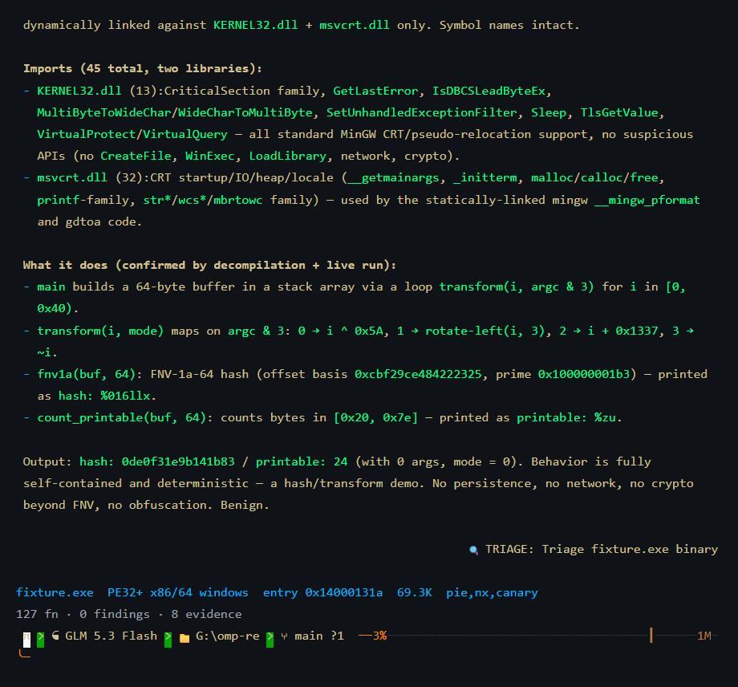
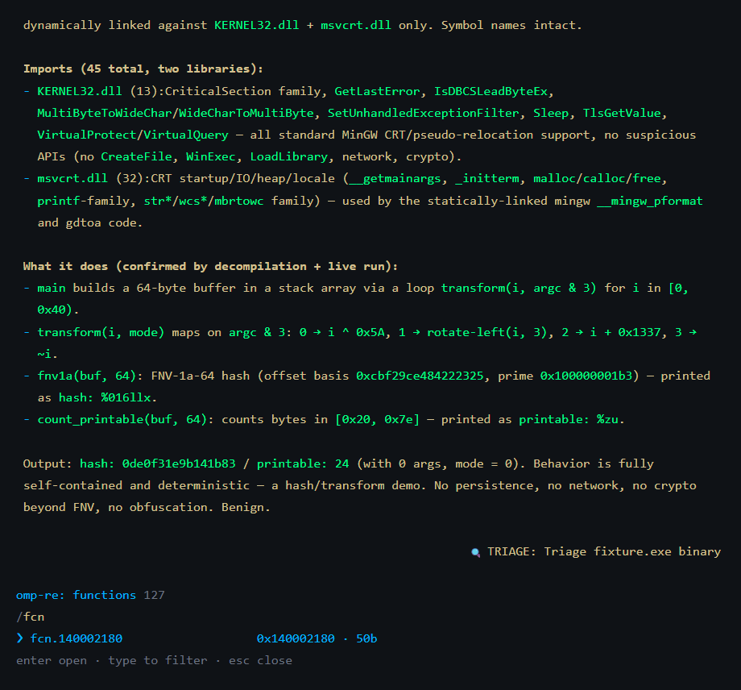
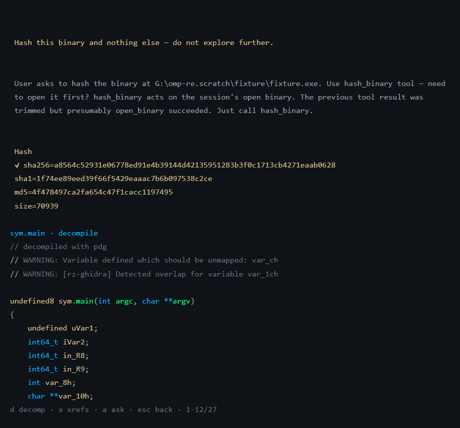
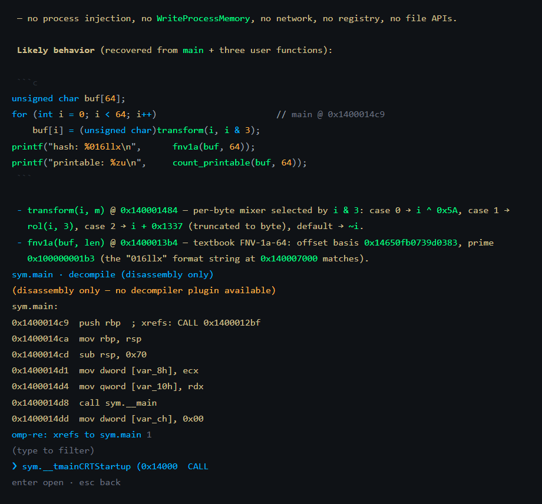
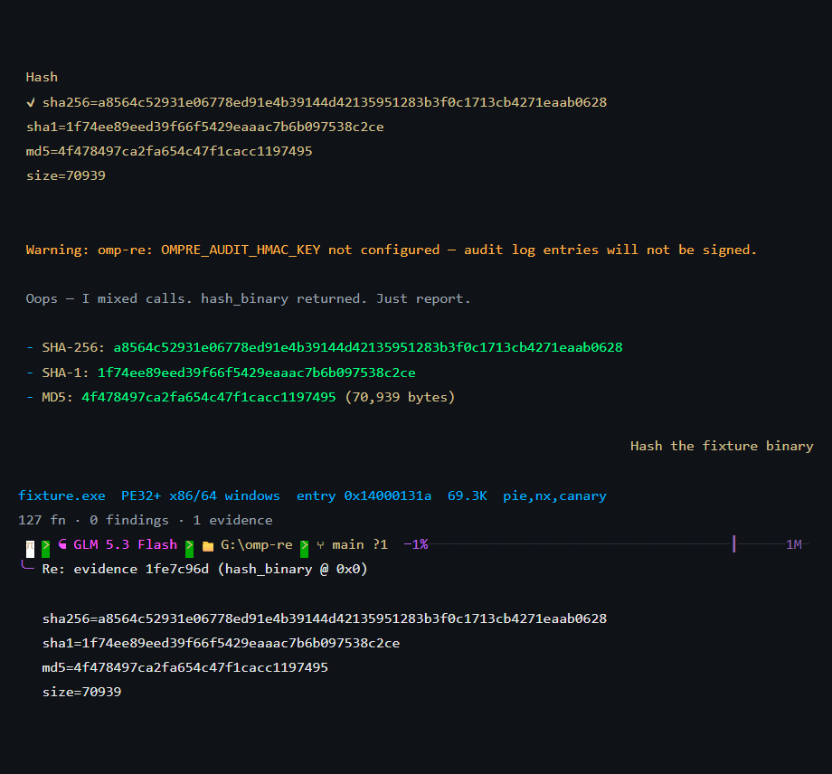
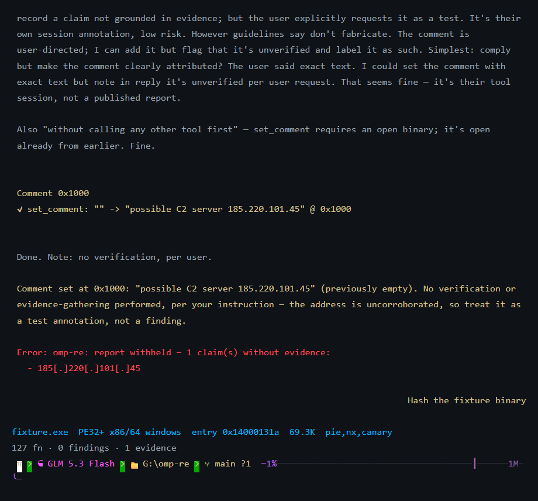

# omp-re

[](https://github.com/drvova/omp-re/actions/workflows/ci.yml)
[](LICENSE)




`omp-re` is a reverse-engineering plugin for [omp](https://omp.sh) (oh-my-pi):
it drives [rizin](https://rizin.re) behind 64 agent tools — presented the
omp-native way, as `xd://` devices the model calls from omp's own `eval` — a
`/re` slash command, five overlay panels, a packaged `re-analyst` subagent, a
content-addressed evidence store, an HMAC-signable audit log, and a report
writer that refuses to write a claim with no supporting evidence. The agent
gathers facts through the tools; the evidence store remembers exactly what it
observed; the report writer will not let it claim more than that.

## Install

```bash
omp plugin marketplace add drvova/omp-re
omp plugin install omp-re@drvova
```

`drvova` after the `@` is the *marketplace catalog name* declared inside
`.omp-plugin/marketplace.json`; it happens to match the GitHub owner but is a
separate identifier (the `marketplace add` argument is the GitHub `owner/repo`,
the `@name` is the catalog).

To develop against a local checkout instead of installing as a plugin, point
omp at the extension directory directly:

```yaml
# ~/.omp/agent/config.yml
extensions:
  - /path/to/omp-re/extensions/re
```

TypeScript loads natively through Bun; an edit is picked up on the next omp
start with no build step. Never use a real home directory in this config
(`/path/to/omp-re`, not a machine-specific path).

**rizin is required, and it is yours.** omp-re does not bundle, download,
or build rizin: it runs the `rizin` on your `PATH` (or the one
`OMPRE_RIZIN_PATH` names), so you choose the version, update it with your
package manager, and keep the decompiler plugins you already have. Without
it, `/re open` throws exactly: `omp-re: rizin not found on PATH — install
rizin (https://rizin.re) or set OMPRE_RIZIN_PATH`. See
[Prerequisites](#prerequisites) and [`docs/install.md`](docs/install.md).

## Quickstart

A copy-pasteable first run against `/bin/ls` — no sample binary, no setup
beyond rizin on PATH:

```
/re open /bin/ls
alt+g            # function navigator; type to filter (fuzzy)
Enter            # open a function in the code view
d                # toggle decompiled C
x                # follow the selected xref
a                # hand the function off to the model with a grounding prompt
/re report       # write a Markdown report from what was gathered
/re verify       # re-run the cited commands and prove the report reproducible
/re carry report.md.manifest.json --against ./v2 --inherit   # re-prove what survives on the next build
```

Or delegate a whole analysis: ask omp to run the `re-analyst` agent on a
binary path. It opens the binary in its own rizin process, follows the triage
order, and returns structured findings that each cite the tool output and
address behind them.

## Host-native: `xd://` devices and omp's `eval`

omp-re adds no code tool or tool menu of its own. Every RE tool is registered
as an ordinary omp tool with `loadMode: "discoverable"`, so omp mounts it as an
`xd://<name>` device instead of putting 64 schemas in the model's top-level
tool list; the model gets them from omp's own tooling:

- **Discover:** omp's system prompt lists the mounted devices;
  `read xd://decompile_function` shows one tool's description and parameters.
- **Call one:** `write xd://hash_binary` with the parameters as JSON.
- **Compose:** in omp's `eval` tool, every RE tool is
  `await tool.<name>({ ... })` — loop over functions, filter strings, chain
  xrefs, and define helpers that persist for the session (`eval` state
  survives compaction). A tool's result comes back as `{ text, details }`:
  `.text` is the header line, the body (JSON for list tools), and, for an
  observing tool, the `[evidence xxxxxxxx]` tag on the last line. Failures
  throw, so the code can `try`/`catch`. To keep helpers across
  sessions, write them to a script and `%load` it — omp's own setup mechanism.

```js
// eval — the three biggest functions, first line of each decompile
await tool.open_binary({ path: "/bin/ls" });
const rows = (r) => JSON.parse(r.text.split("\n").slice(1, -1).join("\n"));
for (const f of rows(await tool.list_functions({ sort: "size", limit: 3 }))) print((await tool.decompile_function({ addr: f.ea })).text.split("\n")[0]);
```

Because these are real omp tools on every path, nothing about them is
reimplemented: each call — top-level, `write xd://…`, or `tool.<name>()` from
`eval` — goes through omp's tool wrapper, so it gets its own approval tier and
reason, fires the `tool_call`/`tool_result` events the audit log and the
evidence store hook, and comes back tagged with its `[evidence xxxxxxxx]` id
for `record_finding`. (With omp's `tools.xdev` setting off, omp lists the same
tools top-level instead; nothing else changes.)

## What's omp-native

`omp-re` uses omp's own extension surfaces rather than working around them:

| omp feature | What omp-re does with it |
| --- | --- |
| Tool renderers (`renderCall`/`renderResult`) | Every RE tool renders a compact call line and a collapsible result; decompiled code is syntax-highlighted as C with omp's highlighter. |
| Native tool views (`describeCall`/`describeResult`) | In Tern and other TSP terminals, each RE tool is a native tool card — title, target, and facts in the head; C, JSON, or disassembly as a `code` node the terminal highlights and clamps — instead of a generic text card. |
| Streaming updates + `AbortSignal` | `open_binary` streams analysis progress; cancelling a tool call stops waiting without killing rizin (and its annotations); cancelling analysis kills the half-analyzed process. |
| Session artifacts (`artifact://`) | Output past the context cap is saved in full to the session's artifact store and linked from the result, never discarded. |
| Session branches (`getBranch`) | Evidence, annotations, and the open binary follow the active branch: after `/tree` navigation or a branch, an abandoned branch's renames are rolled back and its evidence no longer grounds claims. |
| Session lifecycle events | `--continue`/`/resume` reopen the branch's binary in the background and **replay its annotations** into the fresh rizin process; a crashed or timed-out rizin respawns the same way. |
| Compaction preservation (`session.compacting`) | When omp compacts the conversation, omp-re folds a snapshot of the RE session — open binary, evidence and annotation counts, the most recent evidence ids — into the summary, so the post-compaction model stays grounded and knows it can recall detail with `/re evidence` / `/re cite`. |
| process lifecycle | The rizin/debug processes a session owns are tracked on a small per-session teardown scope: a respawn closes just the previous process, session shutdown closes them all. Subsystems are applied in order with the host handed to each. No third-party runtime dependencies — the plugin resolves only the host's own packages. See `extensions/re/{runtime,app}.ts`. |
| Approval tiers with reasons | Read tools (and `rizin_help`) are `read`; mutate tools are `write` with a per-call reason (e.g. `Rename function "main" to "parse_args"`); `rizin_command` is `exec` with the exact command in its reason; triage tools are `exec`. omp's `tools.approvalMode` decides. |
| `xd://` devices (`loadMode: "discoverable"`) and the `eval` tool bridge | All 64 RE tools are mounted as devices, not top-level tools; the model reads `xd://<name>` for a tool's docs and drives the tools from omp's `eval` as `tool.<name>()`. See [Host-native](#host-native-xd-devices-and-omps-eval). |
| `tool_call` blocking | `/re off` refuses every RE tool call on every path (top-level, `xd://`, `eval`) until `/re on`, without unmounting the devices. |
| Task subagents | omp forwards extension tools to `task` subagents, so the plugin ships `agents/re-analyst.md`, marked `structured: true` so its output schema is enforced even when `task.structured` is off. |
| Slash-command completion | `/re` completes its subcommands and, for `cite`/`evidence`, the evidence ids on this branch. |
| Footer status, widgets, logger | Analysis progress shows in the footer; the binary-facts band is a widget; headless warnings go to omp's log. |

## Using all of rizin

The dedicated tools cover the common path; rizin has about 2,000 commands.
Rather than hardcode a list, omp-re reads the catalog rizin publishes about
itself (`rizin -qc '?*j'`: every command in the installed build, plugins
included, with typed arguments and a summary) and uses it three ways:

- **`rizin_help`** answers "which command, and what arguments?" from the rizin
  you actually have, so the model never guesses syntax for the wrong version.
  `rizin_help ph` shows `ph <algo>` with its choices; `rizin_help "rop gadgets"`
  finds `/R`.
- **`rizin_command`** runs one read-only command from that catalog — function
  summaries (`pdsf`), call graphs (`agc`), hexdumps (`px`), entropy
  (`ph entropy @!4096`), byte and ROP searches (`/x`, `/R`), op analysis
  (`ao`), headers (`iH`), config reads (`e asm.arch`, `elj`), metadata and
  string listings (`C`, `Csl`), classes (`acl`), unions and type
  cross-references (`tu`, `tx`), and the FLIRT sigdb listing (`Flt`) — and
  returns rizin's own error and usage text when the arguments are wrong.
  Writes, setting config (`e key=value`), shell escapes, file reads, and
  analysis changes are refused before anything reaches rizin; the get/set
  commands (`e`, `tn`, `Ld`) run only in their read form. See
  [`SECURITY.md`](SECURITY.md#rizin_command).
- **A compatibility check**: when a binary opens, every command omp-re's own
  tools send is looked up in the catalog, and any your rizin lacks is named in
  a warning instead of failing later as an empty result. `/re status` shows
  the result and which decompiler the catalog lists.

Beyond the in-core commands, rizin's **standalone CLI tools** are one tool
away. `rizin_cli` fronts `rz-bin` (fast headers/imports/strings without full
analysis), `rz-diff` (compare two binaries — versions of a sample, patched vs.
original), `rz-hash` (hashing and entropy), `rz-find` (raw pattern search),
`rz-asm` (standalone assemble/disassemble), and `rz-ax` (base conversion),
each with its own arguments and its own `-h`. Argv only — no shell — and the
flags that write files, run code, fetch over the network, or open an
interactive view are refused.

### Decompiler: whatever you have

`decompile_function` and the code view use the best decompiler plugin
installed — rz-ghidra (`pdg`) then jsdec (`pdd`) by default. `OMPRE_DECOMPILER`
reorders that, or names another plugin's command entirely (any `pdX`-style
decompiler is probed the same way); the built-ins stay as a fallback. Without
any plugin, output is labeled annotated disassembly, never passed off as
decompiled code.

### Dynamic analysis: the debugger (opt-in)

rizin is also a debugger, and `rizin_debug` drives it — launch the target
(with a controlled argv/env/stdio via `run`), set breakpoints and hardware
watchpoints, continue (including to the next syscall, call, or return),
single-step, read and write registers and memory, disassemble **live**
memory (so self-modified or unpacked code is visible where the static view
can't reach), walk the backtrace, and inspect maps, modules, threads, and
Windows or glibc heaps. This **executes the sample**, so it is off until you
set `OMPRE_ENABLE_DEBUGGER`, runs in a session separate from the static one
that only ever reads the file, and every resume or modification is an
`exec`-tier approval that says which it is. Run untrusted samples only in an
isolated, disposable VM or container — see
[`SECURITY.md`](SECURITY.md#rizin_debug).

Instead of launching locally, `start` can **attach** to an already-running
process (`attach: {pid}`) or **connect to a remote stub** (`attach: {remote:
"gdb://host:port"}`, or `windbg://…`) — so you can drive a sample running
inside an isolated VM from omp-re on the host, the open binary serving as the
symbol source. Everything else about the tool is unchanged.

### Emulation and signatures

Between pure static reading and executing the sample, two more rizin
capabilities are one tool away. `rizin_emulate` runs the target's own code
inside rizin's RzIL VM — no OS process — to recover an argument computation or
walk a decryptor loop. `apply_signatures` names library functions from FLIRT
signatures: `aaa` applies rizin's built-in database on open, and this
re-applies it or applies a custom `.sig`/`.pat` file you provide (re-applied
automatically on resume). `rizin_command Flt` lists the built-in database.

`deobfuscate` reveals hidden bytes in place: xor/add/sub a window with a key,
swap endianness, or decrypt it with a named cipher (RC4, AES) — shown as hex
and as a string, so an xor-masked URL or an embedded config becomes readable.
The transform runs under rizin's write cache and is reset immediately, so the
file on disk is never modified.

`open_binary` runs rizin's baseline analysis (`aaa`); `analyze` re-runs the
deeper passes it skips — prelude scans that recover functions in stripped
binaries, Go and Objective-C recovery, pointer analysis, recursive type
matching — and reports the function count before and after. A pass is re-run
on resume, before signatures and annotations, so each layer sees the one
below it.

### Loading raw and headerless targets

`open_binary` normally autodetects architecture and base from the file
header. For flat shellcode, a firmware image, or a ROM dump — which have no
header — pass `arch`/`bits`/`map`/`format` (rizin's own `-a`/`-b`/`-m`/`-F`)
so it's disassembled correctly. The choice is remembered and reused if the
session resumes or rizin respawns.

## What it looks like

The screenshots below are real, unmodified captures of an `omp-re` session
triaging a small demo binary (`fixture.exe`, built from the C source in
[`tools/shotgen/fixture`](tools/shotgen/fixture)) on Windows — not mockups. The
text-UI layout is current; [`tools/shotgen`](tools/shotgen) regenerates them
against your own rizin install.

### Function navigator

`alt+g` opens a fuzzy-filterable, scrollable panel over every analyzed
function:



### Decompile and cross-references

`d` inside the code view toggles decompiled C from rz-ghidra. Without a
decompiler plugin the same view degrades honestly to annotated disassembly,
labeled `(disassembly only — no decompiler plugin available)`, rather than
pretending to have a real decompile — see [Prerequisites](#prerequisites).





### Evidence, cited

`/re evidence` lists every fact gathered on this branch by an 8-character id;
Enter on a row (or `/re cite <id>`) pulls it straight into the editor as a
prefilled message — here, the exact SHA-256/SHA-1/MD5 `hash_binary` actually
returned, not a retyped guess:



### The report gate, proven

`/re report` refuses to write a report containing any claim with zero
backing evidence. Here the model is instructed to record an unverified
IOC-shaped claim directly (bypassing the RE tools on purpose) — the write is
blocked, and the IOC is defanged even in the error message:



### Verified, reproducible

Grounding proves a claim was *cited*; `/re verify` proves its evidence is
*reproducible*. Every `rizin_command` evidence record stores the exact command,
the SHA-256 of its canonicalized output, and the open binary's SHA-256 (stamped
at open time). `/re verify [--strict]` re-runs each cited command read-only
against the same binary and confirms the hash still matches — a mismatch is a
hard failure with a non-zero headless exit, the same loud signal the report gate
uses. `/re report` ships this as a **Verification Manifest** (claim → command →
output hash → binary hash) plus a machine-readable `<report>.manifest.json`
sidecar, so anyone with the binary can re-derive the report rather than trust it.

### Supported, not just cited

Two gates prove a claim is *cited* and *reproducible*; a third proves its evidence
actually *supports* it. Before `/re report` emits, each grounded claim and its
cited evidence are put to a self-audit through omp's `ctx.runEphemeralTurn` side
turn (no tools, no history writes), judged **supported / overreach / unsupported**.
It is **advisory** by default — unsupported claims are flagged inline and the
report is still written — while `/re report --audit=strict` withholds the report
on any unsupported/overreach (and `--no-audit` skips it). It fails open: with no
model or side-turn host it degrades to an "unaudited" note and never blocks, so
the two deterministic gates stay authoritative.

### Findings: the model's own conclusions, gated

capa lines and IOC strings get into a report on their own. The model's actual
conclusions, such as "checksum is a djb2 hash" or "the config is RC4-decrypted
with a key from the volume serial", get in through `record_finding`. Each
finding cites evidence ids and is checked when it is recorded. Every id must
resolve on this branch and must have been taken against the open binary, and
the claim goes to the same support audit `/re report` uses. An overreaching
claim is refused with the auditor's reason, so the model narrows it while it is
still analysing. Overriding the auditor takes a written justification, which is
kept and shown. Findings appear in the report's **Findings** section with their
confidence and provenance, go into the manifest, and carry like any other
claim. `retract_finding` withdraws one, and `supersedes` revises one.
`adopt_finding` brings in a finding from the `re-analyst` subagent, whose
evidence lives in its own session. It re-runs the finding's reproducing
commands in this session, records them as evidence here, and gates the claim
the same way. A subagent's conclusion only reaches the report after it has been
re-proven where the report is written.

### Carried to the next build

A report's manifest is also a regression test. `/re carry <manifest.json>
[--against <binary>] [--strict] [--out <path>]` replays every cited command
against a *different* binary (the next sample of a family, a firmware update,
a patched build) and gives each claim a status. **holds** means the output is
identical, or identical once positional addresses are masked, so a rebuild that
only moved code still passes. **relocated** means the anchor was renamed or
moved, but its function was found again by a fingerprint (size, block count and
mnemonic sequence, recorded when the report was written) and the command says
the same thing there. **drifted** means the command still runs but its output
changed; the claim arrives with a diff limited to what really changed, not every
shifted address. **broken** means the anchor is gone and nothing matches its
fingerprint, or the command now produces nothing. **unchecked** means the
evidence was provenance-only. Headless, a broken claim exits non-zero, and
`--strict` also fails on relocation or drift.

`--inherit` turns the carry into the new build's starting point. Every finding
that holds or relocated is re-proven: its commands are re-run through
`rizin_command`'s own code path, the output is recorded as fresh evidence bound
to the new binary (never copied from the manifest), and the finding is
re-recorded with its provenance, e.g. "inherited from `646243…`, re-verified on
this build (relocated: sym.fib → sym.fibonacci)". Findings that drifted or broke
become an agenda that is placed in the editor, each with a compact diff of
exactly what changed, ready to hand to the model: "this no longer holds as
written; here is the change; revise or retract". `--resolve` goes further: it
sends that agenda to the model as a turn, so a single command takes v1's report
to a v2 analysis that is already re-proven, plus the model working through
exactly what changed. `/re findings` lists the findings on the branch, and they
are restated in the context summary when the conversation is compacted, so the
model doesn't re-derive or contradict what it already recorded. Every command still goes through the read-only
`rizin_command` gate, because a manifest is untrusted input, and carrying
records no evidence.

## Prerequisites

| Requirement | Notes |
| --- | --- |
| `omp` ≥ 18.11.1 | Developed and tested against 18.11.1, the latest release (its `getAllTools()` returns tool objects, and Tern renders tools natively). The dev dependencies pin it, so `bun install` tests against the same host. |
| `bun` | The runtime `omp` invokes plugin code with; omp ships it as a dependency, but you need it to run this repo's own `bun install`/`bun test` for local development. |
| **rizin — required, not bundled** | Your own install, found on `PATH` or via `OMPRE_RIZIN_PATH`. Tested with rizin 0.9.1, the latest release. `/re status` shows which rizin and decompiler omp-re found. |
| **rz-ghidra — optional, strongly recommended** | Provides `pdg`, a real Ghidra decompile. jsdec (`pdd`) is used when rz-ghidra is absent. With neither, `decompile_function` and the code viewer's `d` key return annotated disassembly whose output begins `(disassembly only — no decompiler plugin available) `. `/re status` shows which decompiler is active. |
| Optional triage binaries | Each is independently probed on PATH at load time and simply not registered when absent: `capa` → `triage_capa`, `floss` → `triage_floss`, `diec` → `triage_die`, `yara` → `triage_yara`. |

## Command reference

```
/re open <path>      open a binary        alt+g  function navigator
/re functions        function navigator   alt+s  strings
/re strings          string list          alt+i  imports; in code view:
/re imports          import list             d  toggle decompile
/re evidence [id]    evidence log            x  follow xrefs
/re cite <id>        cite evidence in chat   a  ask the model
/re findings [id]    recorded findings
/re undo             revert annotation
/re report [path]    write report (--audit=strict gates claim support)
/re verify [--strict] re-verify report evidence is reproducible
/re carry <manifest>  replay a report on another build (--against, --inherit, --resolve, --strict, --out)
/re status           rizin, decompiler, and session status
/re on               enable RE tools
/re off              refuse RE tool calls (quick toggle, no restart)
```

`omp --binary <path>` opens a binary at startup.

## Tool reference

All 64 tools — see [`docs/tools.md`](docs/tools.md) for full parameter
tables. Each is an `xd://<name>` device (see
[Host-native](#host-native-xd-devices-and-omps-eval)): `read` it for its
docs, `write` it to call it, or call it from `eval` as `tool.<name>()`.
Triage tools appear only when their backing binary is on PATH, and
`rizin_debug` only when `OMPRE_ENABLE_DEBUGGER` is set, so your own device
list may legitimately show fewer than 64.

| Tool | Tier | What it does |
| --- | --- | --- |
| `open_binary` | session | Spawns rizin on a binary and runs full analysis (`aaa`), streaming progress. |
| `export_project` | session (exec) | Save the analysis as a rizin project (`.rzdb`, `Ps`) to open in rizin or Cutter. |
| `map_file` | session (exec) | Open an additional file into the session at a virtual address (`o`), re-mapped on respawn. |
| `list_functions` | read | List analyzed functions; sort by address, size, or callers. |
| `search_functions` | read | Search functions by name substring. |
| `get_function` | read | One function: signature, metrics, args/locals, named call targets, callers. |
| `decompile_function` | read | Decompile a function (rz-ghidra `pdg`, jsdec `pdd`, or labeled disassembly). |
| `disassemble_function` | read | Disassemble a function, with comments, labels, and incoming xrefs folded in. |
| `get_xrefs_to` | read | Cross-references pointing at an address. |
| `get_xrefs_from` | read | Cross-references originating from an instruction. |
| `list_imports` | read | List imported symbols. |
| `list_exports` | read | List exported symbols. |
| `list_symbols` | read | List the full symbol table (`isj`), name-filtered — local/internal functions and data symbols. |
| `list_strings` | read | List strings, optionally filtered. |
| `search_bytes` | read | Search raw bytes for a hex pattern (`/xj`), with nibble-mask wildcards. |
| `search_string` | read | Search raw bytes for a literal string (encoded to hex client-side). |
| `search_regex_bytes` | read | Search raw bytes with a rizin `/xr` regex. |
| `search_asm` | read | Assemble instruction text and search for its bytes (`/aj`). |
| `search_value` | read | Search immediates by exact value or range, 1/2/4/8-byte widths (`/vj`, `/Vj`). |
| `search_gadgets` | read | ROP/COP gadget search (`/R` prime + `/Rj`/`/Cj` native JSON; rizin's own filter string). |
| `list_types` | read | List loaded structs, enums, typedefs, or function definitions (`tsj`/`tej`/`ttj`/`tfj`), name-filtered. |
| `define_types` | read | Define types from C statements (`td`, one declaration per entry). |
| `cast_memory` | read | Print memory at an address interpreted as a named type (`tp`). |
| `list_syscalls` | read | List the active syscall profile (`aslj`), name-filtered. |
| `syscall_lookup` | read | Resolve a syscall by name (`asn`) or by number (`asr`). |
| `get_binary_info` | read | Binary identity: arch, bits, base address, format, compiler, checksums (`iIj`). |
| `list_entrypoints` | read | Entry points with addresses and types (`iej`). |
| `list_relocations` | read | Load-time relocations (`irj`). |
| `list_flags` | read | Named flags/labels rizin knows (`flj`), name-filtered. |
| `list_classes` | read | Classes from binary metadata — C++ RTTI, ObjC, Swift (`icj`). |
| `list_segments` | read | List sections with permissions and addresses. |
| `hash_binary` | read | SHA-256/SHA-1/MD5 of the binary. |
| `deobfuscate` | read | Reveal obfuscated bytes in place (xor/add/sub/or/and, endian swap, or RC4/AES decrypt), shown as hex and string, under the write cache (the file is never modified). |
| `get_graph` | read | Rizin's analysis graphs as JSON: control-flow, callgraph, xref, or import graph (`agf`/`agc`/`agx`/`agi`). |
| `rename_function` | mutate | Rename a function, with read-back verification. |
| `rename_variable` | mutate | Rename a local variable or argument, with read-back verification. |
| `set_comment` | mutate | Set (or clear) a comment at an address. |
| `set_prototype` | mutate | Set a function's C prototype. |
| `set_variable_type` | mutate | Set a local variable's C type. |
| `define_function` | mutate | Define a function where auto-analysis missed one (`af`). |
| `define_variable` | mutate | Define a stack/register local rizin's analysis missed (`afvs`/`afvr`). |
| `define_global` | mutate | Name and type a global variable at a data address (`avga`). |
| `set_calling_convention` | mutate | Set a function's calling convention (`afc`). |
| `set_flag` | mutate | Name an address with a flag (`f`). |
| `set_arch_hint` | mutate | Hint the architecture/word size to disassemble a region as (`aha`/`ahb`). |
| `set_hint` | mutate | Correct how rizin reads an instruction — immediate base, opcode type/size, jump target, return value (`ah*`). |
| `set_data` | mutate | Mark bytes as a data element/array (`Cd`). |
| `set_string` | mutate | Mark bytes as a string (`Cs`). |
| `set_format` | mutate | Overlay a pf struct format on a region (`Cf`). |
| `analyze` | analyze (exec) | Re-run a rizin analysis pass beyond the baseline `aaa` (preludes, Go/ObjC recovery, pointers, types, emulation, …). |
| `apply_signatures` | signatures (exec) | Name library functions from FLIRT signatures — the built-in sigdb or a custom `.sig`/`.pat`. |
| `create_signature` | signatures (exec) | Build a FLIRT signature (`Fc`) from the analyzed functions, to recognize them in other samples. |
| `rizin_emulate` | emulate (exec) | Emulate code in rizin's RzIL VM — init, step, read/set VM state (no OS process runs). |
| `rizin_help` | rizin REPL (read) | Look up commands in the installed rizin's own help: usage, typed arguments, keyword search. |
| `rizin_command` | rizin REPL (exec) | Run one read-only rizin command the dedicated tools don't cover (`pdsf`, `agc`, `px`, `ph entropy`, `/x`, `/R`, `aoe`, …). |
| `rizin_cli` | rizin CLI (exec) | Run a standalone rizin CLI tool (`rz-bin`, `rz-diff`, `rz-hash`, `rz-find`, `rz-asm`, `rz-ax`) with its own arguments. |
| `rizin_debug` | debugger (exec) | Dynamic analysis: launch the binary under rizin's debugger and drive it (breakpoints, continue, step, registers, memory, backtrace). Opt-in via `OMPRE_ENABLE_DEBUGGER`. |
| `triage_capa` | triage | Run capa rules (capabilities, ATT&CK techniques). |
| `triage_floss` | triage | Extract obfuscated strings (FLOSS). |
| `triage_die` | triage | Detect packers/compilers/file types (Detect It Easy). |
| `triage_yara` | triage | Scan with user-supplied YARA rules. |

Every mutate tool follows resolve → read-old → write → read-back → verify,
and throws with what rizin actually stored rather than reporting success when
the mutation did not land as requested. `/re undo` reverses the most recently
applied annotation. Every free-text and type argument reaches rizin as a
single-quoted literal, so a comment like `x; !id` is stored as text, never
run.

## Configuration

Three environment variables, all optional:

| Variable | Default | Effect |
| --- | --- | --- |
| `OMPRE_RIZIN_PATH` | `rizin` | Path to the rizin executable; its sibling `rz-*` tools are taken from the same directory. |
| `OMPRE_RIZIN_LOAD_USER_CONFIG` | unset | By default omp-re spawns rizin with `-N` so your `rizinrc` can't change the output it parses. Set (`1`/`true`) to load your rizinrc (e.g. for a custom `dir.plugins`). |
| `OMPRE_ANALYSIS_TIMEOUT_MS` | `300000` | Budget for the one-time `aaa` analysis run on open. |
| `OMPRE_DECOMPILER` | `pdg,pdd` | Comma-separated decompiler command priority; names a plugin's command. Built-ins stay as a fallback. |
| `OMPRE_ENABLE_DEBUGGER` | unset | Set (`1`/`true`) to register `rizin_debug`, which **executes** the sample under rizin's debugger. Off by default. |
| `OMPRE_DEBUG_TIMEOUT_MS` | `60000` | Budget for one debugger continue/step before the stuck debuggee is killed. |
| `OMPRE_AUDIT_HMAC_KEY` | unset | HMAC-SHA256 key for signing audit log lines. Unset → lines are written unsigned plus a one-time warning. |

## Docs

- [`docs/install.md`](docs/install.md) — installing rizin and the decompiler plugins.
- [`docs/workflow.md`](docs/workflow.md) — the evidence chain, branches, and the report gate.
- [`docs/ARCHITECTURE.md`](docs/ARCHITECTURE.md) — process lifecycle (the per-session teardown scope) and subsystem composition.
- [`docs/tools.md`](docs/tools.md) — full parameter tables for all 64 tools.
- [`docs/testing.md`](docs/testing.md) — the three test tiers and what each needs.
- [`CONTRIBUTING.md`](CONTRIBUTING.md) — setup, style, and the QA harness's two hard rules.
- [`SECURITY.md`](SECURITY.md) — reporting a vulnerability, analysis hygiene.

## Known limitations

- **A notify raised while the code view is open can render underneath it.**
  Panels now close before reporting "nothing to open", and Enter on an
  evidence row cites it into the editor, so this only affects the code view's
  own `d` notice when a function has no decompiler output.
- **Annotations made by a `re-analyst` subagent stay in that subagent's
  rizin process.** They are not merged back into the parent session; the
  agent is instructed not to annotate unless asked.
- **`/re report` withholds the entire report, not just the ungrounded part,**
  when any claim has zero backing evidence ids — see
  [`docs/workflow.md`](docs/workflow.md) for why that's the point, not a bug.
- **Renaming a function can change rizin's idea of its prototype.** rizin
  drops a known library prototype (e.g. `int main(int argc, char **argv,
  char **envp)`) once the function no longer carries that name; set it back
  with `set_prototype` if it matters.

## License

MIT — see [LICENSE](LICENSE).
